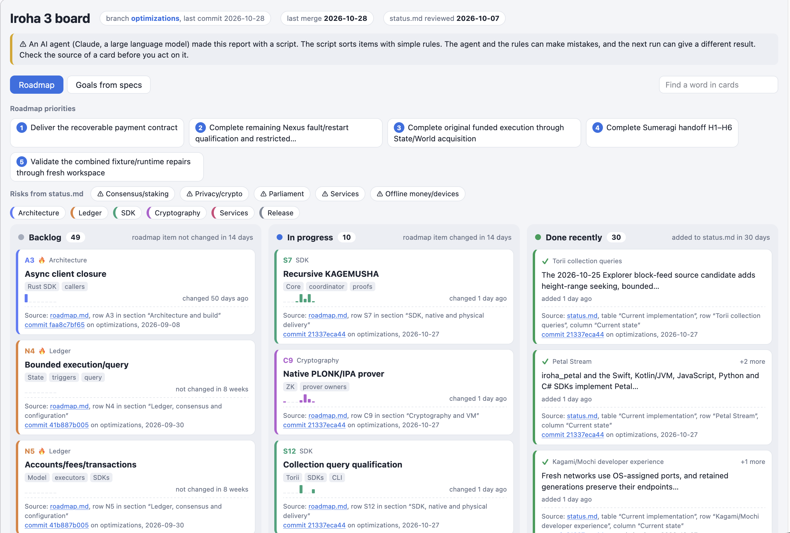

# SDI plugins

Personal Claude Code plugins for Iroha 3 and CBDC Android work.

## Plugins

| Plugin | Skills |
| --- | --- |
| `iroha` | `iroha-dashboard-generator`: issue-board HTML dashboard from `roadmap.md`, `status.md` and spec goal files |

### Dashboard generator

The skill reads `roadmap.md`, `status.md` and the goal tables in `specs/` on the active Iroha branch.
It then builds one HTML page that shows the current progress as an issue board.
Roadmap items go to the Backlog, In progress and Done recently columns.
Each card links to its source row and to the last commit that changed it.

Ask Claude Code for "iroha board" or "roadmap dashboard" to run it.

> [!WARNING]
> The dashboard is not a source of truth.
> An LLM and simple sort rules make the page, and both can make mistakes.
> Use the page only as a starting point for deeper research.
> Check the source of a card before you act on it.



## Install

Run from the root of a local clone of this repository:

```bash
claude plugin marketplace add .
claude plugin install iroha@sdi-plugins
```

After a change in this repository, update the installed copy:

```bash
claude plugin marketplace update sdi-plugins
claude plugin update iroha@sdi-plugins
```

## Add a plugin

1. Create `plugins/<name>/.claude-plugin/plugin.json` and `plugins/<name>/skills/<skill>/SKILL.md`.
2. Add the plugin to `.claude-plugin/marketplace.json`.
3. Run `claude plugin validate .` from the repository root.
